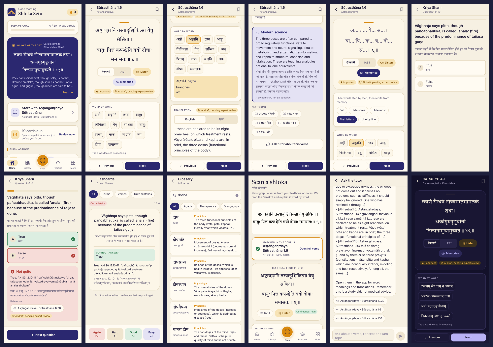

# Shloka Setu · श्लोकसेतुः

**A bridge between the Sanskrit of the Ayurvedic classics and the language BAMS students already think in.**

BAMS students study from Carakasaṃhitā, Suśrutasaṃhitā and Aṣṭāṅgahṛdaya, which are written in Sanskrit, after
schooling in English or Hindi. Shloka Setu is an offline-first phone app that gives every verse:
the shloka in Devanagari/IAST, **tap-able word-by-word meanings, English and Hindi translations,
an explanation, and a careful modern-science correlation**. It adds a **camera "scan a shloka"**
feature, quizzes, spaced-repetition flashcards, a trilingual glossary and an AI tutor.



## What's in this folder

| Path | What |
|---|---|
| `app/` | Expo (React Native) app for Android/iOS/web. See `app/README.md` |
| `server/` | API: search, explain, scan (Claude vision), tutor. See `server/README.md` |
| `content/data/corpus/` | Sanskrit text of AH, CS and SS: about 25,000 verses. See its README for sources and licences |
| `content/data/translations/` | Bilingual study translations (AI draft, pending expert review) |
| `content/data/quiz/` | Bilingual MCQ banks per NCISM subject |
| `content/data/glossary.json` | 918 Sanskrit terms with Hindi, English and modern correlates |
| `content/scripts/` | Corpus builders, validator, status report |
| `docs/` | PRD, architecture, research, content status, expert-review notes, screenshots |

Current numbers are in [`docs/CONTENT_STATUS.md`](docs/CONTENT_STATUS.md).

## Quick start

```bash
# 1. API (runs in mock mode without a key)
cd shloka-setu/server && npm ci && npm run dev          # http://localhost:8787

# 2. App
cd shloka-setu/app && npm ci && npm run content && npx expo start
#   press "w" for web, or scan the QR code with Expo Go on your phone
#   on a phone, set the API URL in Settings to http://<your-computer-LAN-IP>:8787

# 3. Installable Android APK (needs a free Expo account)
cd shloka-setu/app && npx eas-cli build -p android --profile preview
```

Live scan and tutor need `ANTHROPIC_API_KEY` in the server environment (see `server/.env.example`).

## Content quality and licensing
- Everything generated is marked `review_status: "ai_draft"` and shows an "AI draft, pending expert review" badge.
  Start reviewing with [`docs/EXPERT_REVIEW_NOTES.md`](docs/EXPERT_REVIEW_NOTES.md).
- The Sanskrit works are public domain, but the digital transcriptions carry their own terms. DCS is CC BY 4.0,
  Wikisource is CC BY-SA, and the GRETIL and MIU Vedic Reserve texts are "reference only". Clear these, or re-key the text,
  before a commercial launch. Details: `content/data/corpus/README.md` and `docs/research/03-sources-and-licensing.md`.
- This is a study aid. It is not medical advice.

## Docs
- [Product requirements](docs/PRD.md)
- [Architecture](docs/ARCHITECTURE.md)
- [Content schema](docs/CONTENT_SCHEMA.md)
- [Research](docs/research/)
